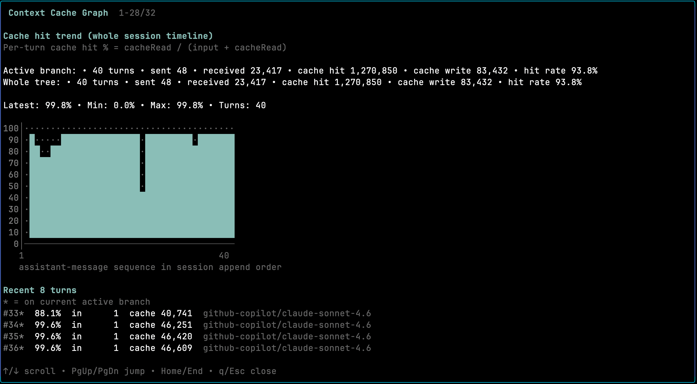

# pi-cache-graph

[](https://www.npmjs.com/package/pi-cache-graph)
[](https://www.npmjs.com/package/pi-cache-graph)

A project-local [pi](https://github.com/mariozechner/pi) extension that adds cache inspection commands for monitoring LLM context cache usage.

This extension was built primarily to add **observability to the [pi-context-prune](https://github.com/championswimmer/pi-context-prune) extension** — which compacts the session context to keep token usage down. `pi-cache-graph` lets you see in real time how effectively the cache is being used and how pruning affects cache hit rates over a session.



## Check out my other Pi extensions

- [](https://github.com/championswimmer/pi-cache-graph) — Real-time prompt cache hit rates and token metrics.
- [](https://github.com/championswimmer/pi-checklist) — Session task checklist with dependencies and a TUI renderer.
- [](https://github.com/championswimmer/pi-context-decisions) — Selects relevant skills and optionally filters tools for each task.
- [](https://github.com/championswimmer/pi-context-prune) — Prunes verbose tool outputs from context while preserving history.
- [](https://github.com/championswimmer/pi-context-usage) — Dot-grid visualization of context window token usage.
- [](https://github.com/championswimmer/pi-gauge) — Live tokens/sec and TTFT in the status bar.
- [](https://github.com/championswimmer/pi-subagent-manager) — Delegate work to parallel subagents and monitor their progress.

Adds cache inspection commands:

- `/cache graph` — shows cache hit % over time for assistant turns across the current session timeline
- `/cache stats` — shows per-message token/cache breakdown for assistant messages across the whole session tree, plus cumulative totals
- `/cache export` — writes the same stats data to `session-name.csv` at the project root

## Commands

### `/cache graph`
Opens a TUI overlay with **three switchable views**:

| Key | View | Description |
|-----|------|-------------|
| `1` | Per-turn (%) | Cache hit % per individual turn (default) |
| `2` | Cumulative (%) | Running cache hit % across all turns so far |
| `3` | Cumulative (total) | Running cumulative token volumes (input / cacheWrite / cacheRead) |

**Keyboard shortcuts inside the dialog:**
- `1` / `2` / `3` — jump directly to that view
- `v` — cycle view forward
- `V` (Shift+v) — cycle view backward
- `←` / `→` (or `[` / `]`) — select the previous / next agent
- `r` — refresh the agent list and selected graph
- `↑/↓`, `PgUp/PgDn`, `Home/End` — scroll
- `q` / `Esc` — close

The graph starts with the main session selected. When [pi-subagent-manager](https://github.com/championswimmer/pi-subagent-manager) has registered subagents on the current branch, use `←` and `→` (or `[` and `]`, not `/`) to view their individual graphs. Completed and stopped agents remain selectable while registered on that branch. Press `r` to discover newly registered agents and reload completed, persisted turns; a response still streaming may not yet appear. Inherited parent context is excluded from subagent usage so it is not counted as a subagent turn. `/cache stats` and `/cache export` continue to use the current session.

All views show active-branch totals and whole-tree totals at the top. For a subagent, the graph covers its saved branch checkpoint (excluding inherited context), so both totals describe that branch rather than abandoned child branches. Subagent sessions lacking inherited-history metadata cannot be graphed safely; the dialog reports this instead.

Cache hit % is computed as:

```text
cacheRead / (input + cacheRead + cacheWrite)
```

The denominator is the full prompt size that was sent in the turn:
- `input` — fresh, non-cached prompt tokens
- `cacheRead` — prompt tokens served from cache
- `cacheWrite` — prompt tokens that were freshly written to cache this turn (Anthropic-style providers report this separately from `input`; OpenAI-style providers report `cacheWrite = 0`, so the formula behaves identically there)

The **cumulative-total** chart uses distinct glyphs per series (`▇` input, `░` cacheWrite, `▒` cacheRead) with a dynamic scale shown in the legend (default: 1 row = 5,000 tokens).

### `/cache stats`
Opens a TUI overlay table that shows:
- one row per assistant message with usage data
- whether the message is on the current active branch
- prompt / received / cache-hit / cache-write tokens
- per-message cache hit %
- cumulative totals for the active branch and the whole tree

### `/cache export`
Writes a CSV to the project root:
- filename: `session-name.csv`
- uses the current pi session name when available
- falls back to the session file basename if the session has no explicit name
- contains summary rows plus the per-message rows shown in `/cache stats`
- can be opened in Excel to build graphs from the exported columns

## Install from npm

Install globally via pi:

```bash
pi install pi-cache-graph
```

Or add it to your pi settings manually in `.pi/settings.json`:

```json
{
  "packages": [
    "pi-cache-graph"
  ]
}
```

Once installed, the `/cache` commands are available in any pi session.

## Install from local source (development)

Clone the repo and run pi with this extension directly:

```bash
git clone https://github.com/championswimmer/pi-cache-graph.git
cd pi-cache-graph
npm install
pi -e .
```

Or install the local path into pi:

```bash
pi install /path/to/pi-cache-graph
```

Or add it to `.pi/settings.json`:

```json
{
  "packages": [
    "/path/to/pi-cache-graph"
  ]
}
```

## Development

```bash
npm install
npm run check
```

## Maintainer release workflow

This repo includes a project-local Pi release workflow for maintainers:

- prompt template: `/release <major|minor|patch>`
- skill: `.agents/skills/release/SKILL.md`
- helper script: `scripts/release.mjs`
- detailed notes: `docs/releasing.md`

The release flow bumps the version, creates the release tag, pushes `main` plus the tag, and then relies on `.github/workflows/publish.yml` to publish to npm.

## Files

- `index.ts` — extension entrypoint
- `src/index.ts` — command registration
- `src/session-data.ts` — session traversal and metric computation
- `src/subagent-data.ts` — subagent registry discovery and read-only checkpoint metrics
- `src/cumulative.ts` — cumulative series computation (pure, no UI dependency)
- `src/cache-math.ts` — cache hit % and totals calculations
- `src/format-utils.ts` — number/percent formatting helpers
- `src/graph-view.ts` — graph rendering
- `src/stats-view.ts` — stats table rendering
- `src/scroll-dialog.ts` — scrollable TUI overlay component
- `src/render-utils.ts` — shared rendering helpers
- `src/export.ts` — CSV export logic
- `src/types.ts` — shared TypeScript interfaces
